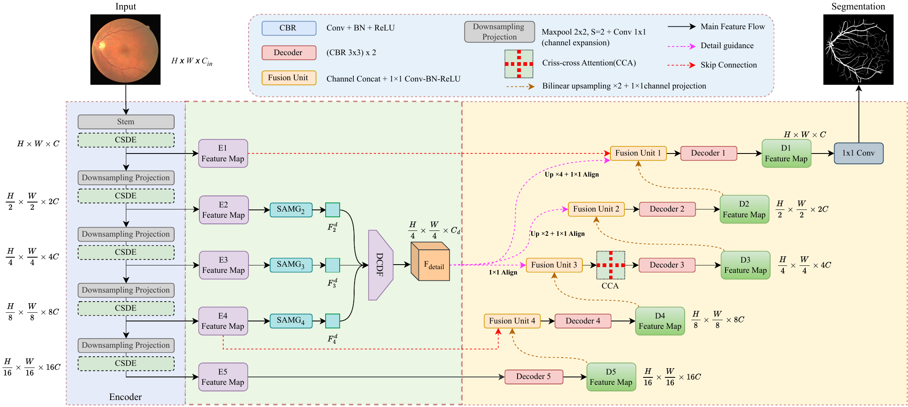

# CGDD-Net: Context-Guided Dynamic Detail Modeling for Retinal Vessel Segmentation

<div align="center">

**Official PyTorch implementation of CGDD-Net**

<p>
  <a href="https://github.com/lixincheng-xcl">Xincheng Li</a><sup>1</sup>,
  Xiaoqi Sheng<sup>2</sup>,
  <a href="https://github.com/zhangxinyu-xyz">Xinyu Zhang</a><sup>1</sup>
</p>

<p>
  <sup>1</sup>School of Computer Science, The University of Auckland, New Zealand<br>
  <sup>2</sup>School of Future Technology, South China University of Technology, China
</p>

<p>
  <a href="https://github.com/lixincheng-xcl/CGDD-Net"></a>
  <a href="https://www.python.org/"></a>
  <a href="https://pytorch.org/"></a>
  <a href="LICENSE"></a>
</p>

</div>

This repository provides the PyTorch implementation of the CGDD-Net architecture described in the manuscript. It includes Context-Guided Scale-Adaptive Deformable Encoding (CSDE), Spatially Adaptive Multi-Kernel Gating (SAMG), Dynamic Cross-Scale Detail Fusion (DCDF), detail-guided decoding, selective skip connections, and one criss-cross attention block at the D3 fusion stage.

[中文说明](README_zh.md) · [Architecture](docs/architecture.md) · [Data protocol](docs/data_protocol.md) · [Release status](docs/release_status.md)



## Manuscript-aligned implementation

The default model uses one grayscale input channel, encoder widths **8, 16, 32, 64, 128**, and an eight-channel shared detail representation. The full model contains **1,956,802 trainable parameters (1.96 M)**. The base learning rate is **0.001**.

The implementation follows the current manuscript design choices:

- CSDE uses four equal-width attention heads with base spacings `(1, 3, 5, 7)` and nine sampling points per head.
- Each head predicts nine 2-D offsets through a zero-initialized `3x3` convolution. The query uses the center-point offset; keys and values use all nine locations.
- Sampling uses bilinear interpolation, border padding, and `align_corners=False`.
- SAMG uses dense `1x1`, `3x3`, `5x5`, and `7x7` CBR branches with global-local adaptive gating.
- DCDF aligns the E2/E3/E4 detail features to the E3 resolution and projects them to the shared detail width.
- The shared detail representation is reused at D3, D2, and D1. Direct encoder skips are retained at E4 and E1.
- Main-path down/up channel projections use `1x1 Conv-BN-ReLU`; the prediction head is a bare `1x1` convolution producing logits.
- A single CCA block is applied after the D3 fusion unit.

The seven cumulative ablations are:

`baseline -> csde -> samg -> dcdf -> detail_decoder -> selective_skip -> full`

## Installation

Python 3.10 or newer is recommended. Install a suitable PyTorch build using the [official installation selector](https://pytorch.org/get-started/locally/), then:

```bash
python -m pip install -e '.[dev]'
python -m pytest -q
python scripts/smoke_test.py
```

The author-confirmed benchmark GPU is NVIDIA H200 141 GB, using Python, PyTorch, and CUDA. The local workstation is a Mac; its operating system is not evidence of the H200 execution host's operating system. Exact historical software versions and compute-host OS are not asserted here. Repository CI and smoke tests check software behavior, not the retinal benchmark scores.

## Data preparation

Obtain DRIVE, STARE, CHASE_DB1, and HRF from their original providers and keep the image data outside the repository. Dataset manifests specify image, label, optional FOV, case ID, and dataset identity. Split validation checks image IDs, original identities, subject identities where available, file paths, and duplicate image content before patch sampling. The author-confirmed experimental protocol is DRIVE `20/20`, CHASE_DB1 `20/8`, STARE `10/10`, and HRF `25/20` (train/test). All STARE experiments used `10/10`; the earlier five-fold description was a writing error, not a change of experiments. Acquisition FOVs are 45°, 30°, 35°, and 60°, respectively; these angles are distinct from pixel-wise FOV masks. Sources and split provenance are recorded in `docs/data_protocol.md`.

```bash
python scripts/prepare_data.py inspect --data-root ../datasets
```

For a new DRIVE experiment, for example:

```bash
python scripts/prepare_data.py generate --data-root ../datasets \
  --dataset DRIVE --strategy drive-official --seed 42 --output splits/new_drive
python scripts/prepare_data.py validate --data-root ../datasets \
  --train splits/new_drive/train.json --val splits/new_drive/val.json \
  --test splits/new_drive/test.json
```

Newly generated protocols are labelled as new experiments and are not presented as historical manuscript split manifests.

## 📦 Pretrained Models

Check the [Releases](https://github.com/lixincheng-xcl/CGDD-Net/releases) page for dataset-specific checkpoints. **No pretrained checkpoint release is currently available.**

For inference with a locally trained model, use the run's `best.pt` checkpoint and its matching configuration in the evaluation command below.

## Training and evaluation

```bash
python train.py --config configs/default.json \
  --train-manifest splits/new_drive/train.json \
  --val-manifest splits/new_drive/val.json \
  --data-root ../datasets \
  --output runs/drive_seed42 \
  --device cuda

python evaluate.py \
  --checkpoint runs/drive_seed42/best.pt \
  --manifest splits/new_drive/test.json \
  --data-root ../datasets \
  --output runs/drive_seed42/test \
  --device cuda
```

The reference configuration uses Adam, base learning rate `0.001`, training batch size `64`, `100` epochs, dropout `0.1`, `64x64` training patches, `150000` sampled patches per epoch, and zero weight decay. Early stopping is disabled in the default configuration so training follows the fixed 100-epoch budget. Linear warmup is followed by cosine cycles with restarts. Validation-based checkpoint selection for new repository runs remains distinct from the original run records.

Inference uses overlapping `64x64` patches with stride `16`; the inference mini-batch default remains `8`. Each patch output is converted from logits to probabilities with sigmoid. Overlapping probabilities are averaged to reconstruct the full-image map before applying threshold `0.5`.

AUC is calculated from each reconstructed full-image probability map; SE, SP, ACC, and F1 use its thresholded prediction. Metrics are computed inside each image's FOV and then averaged without pixel-count weighting. The evaluator exports per-image metrics and probability maps when requested.

## Loss function

Training minimizes FOV-masked binary cross entropy from logits:

```python
loss = (
    F.binary_cross_entropy_with_logits(logits, target, reduction="none") * fov
).sum() / fov.sum()
```

Only pixels inside the FOV contribute. There are no additional Dice, boundary, topology, class-reweighting, or deep-supervision loss terms.

## Reported manuscript results

| Dataset | SE | SP | ACC | F1 | AUC |
|---|---:|---:|---:|---:|---:|
| DRIVE | 0.8421 | 0.9768 | 0.9704 | 0.8323 | 0.9824 |
| CHASE_DB1 | 0.8600 | 0.9815 | 0.9752 | 0.8102 | 0.9938 |
| STARE | 0.8661 | 0.9812 | 0.9775 | 0.8510 | 0.9895 |
| HRF | 0.8362 | 0.9823 | 0.9711 | 0.8157 | 0.9874 |

Machine-readable transcriptions of the manuscript's main, ablation, and cross-dataset tables are stored under `results/`. The author confirmed that the existing STARE results were obtained using `10/10`; correcting the earlier description does not alter these scores. Result transcriptions remain separate from outputs generated by new repository runs. No benchmark values were recomputed during this synchronization.

## Profiling and statistics

```bash
python scripts/profile_model.py --config configs/default.json --batch-size 64 --height 64 --width 64
```

The command records an explicit `64x1x64x64` forward-pass input and the measured parameter count. Add `--fvcore` after installing `.[profile]` to report supported-operator estimates, per-patch normalization, tool versions, and unsupported operations. Use `--batch-size 1` to profile a single patch. These commands do not establish the historical Table 10 profiling shape.

The manuscript reports **1.96 M** trainable parameters and **29.96 GFLOPs** under its common comparison setup. The original profiling tensor shape, counting-library version, and operation convention have not been recovered. A batch of 64 patches has the same pixel count as a `512x512` image, but this does not establish equal network computation. `docs/profile_measured.json` retains dated partial supported-operation estimates; they are not replacements for the reported total or latency measurements.

For future repeated-run analyses:

```bash
python scripts/summarize_runs.py completed_runs.csv \
  --reference CGDD-Net --output statistics.json
```

Table 7 uses one observation per complete test image: its reconstructed-map AUC. Vector lengths are `20` for DRIVE, `8` for CHASE_DB1, and `10` for STARE. Mean and standard deviation describe variation across images. The author-retained Wilcoxon rank-sum p-values compare each method with CGDD-Net, using `p < 0.05` for significance. Original values and stars remain unchanged; they have not been independently recalculated here. `summarize_runs.py` is for new run-level analyses, not Table 7. `python scripts/exact_p_bounds.py` reports theoretical sample-size bounds, never empirical replacements for the original p-values.

## Reproducibility records

A training run stores its resolved configuration, environment metadata, copied manifests and hashes, history, best/latest checkpoints, and training summary. Evaluation can export per-image metrics, probabilities, binary predictions, and provenance. This makes newly executed experiments traceable to a fixed configuration and dataset manifest.

## Publishing and attribution

The software is distributed under the repository license; dataset access and redistribution remain governed by the original dataset providers. Upstream workflow attribution is recorded in `NOTICE` and the corresponding license material is retained under `LICENSES/`.

## 📖 Citation

If you find this work helpful, please cite the [arXiv preprint](https://arxiv.org/abs/2610.05078):

```bibtex
@misc{li2026cgddnet,
  title         = {{CGDD-Net}: Context-Guided Dynamic Detail Modeling for Retinal Vessel Segmentation},
  author        = {Xincheng Li and Xiaoqi Sheng and Xinyu Zhang},
  year          = {2026},
  eprint        = {2610.05078},
  archivePrefix = {arXiv},
  primaryClass  = {cs.CV},
  url           = {https://arxiv.org/abs/2610.05078}
}
```

---

<p align="center">
  ⭐ <strong>If you find this repository useful, please consider giving it a star!</strong>
</p>
