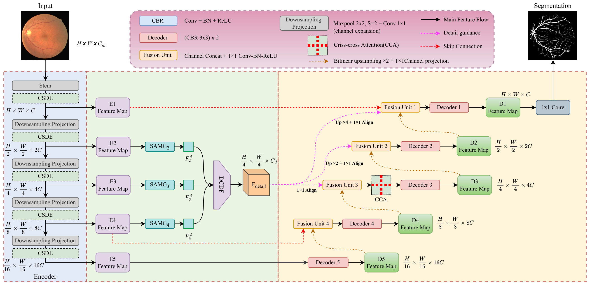
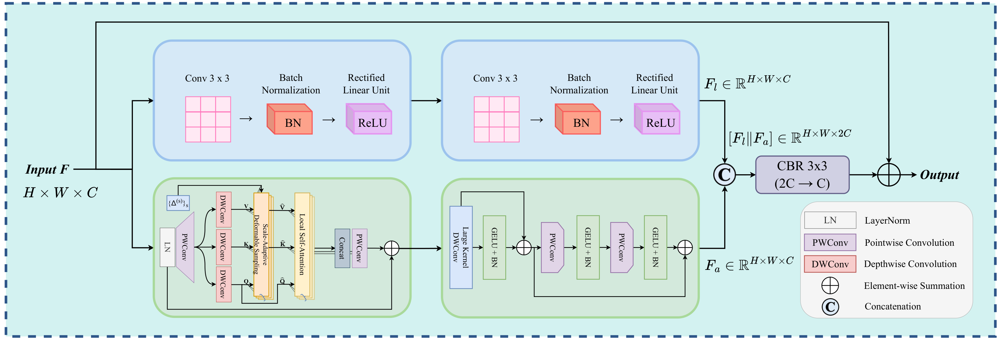
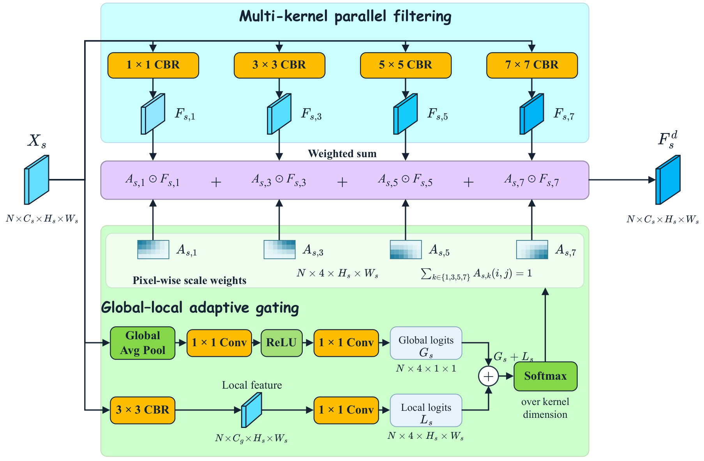
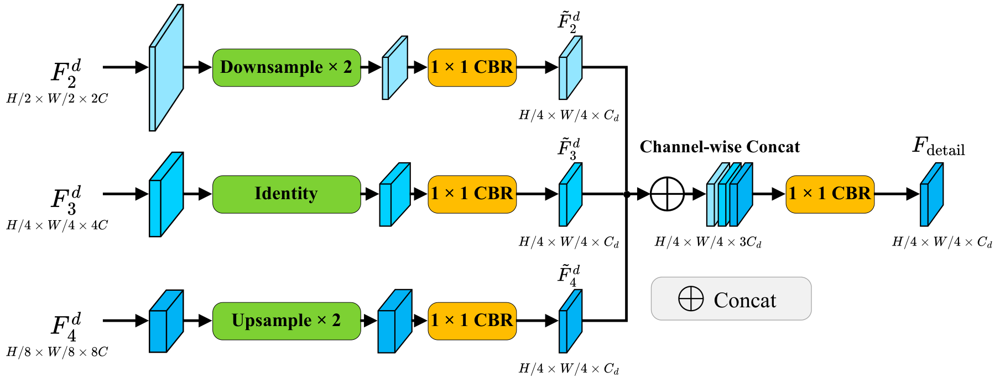
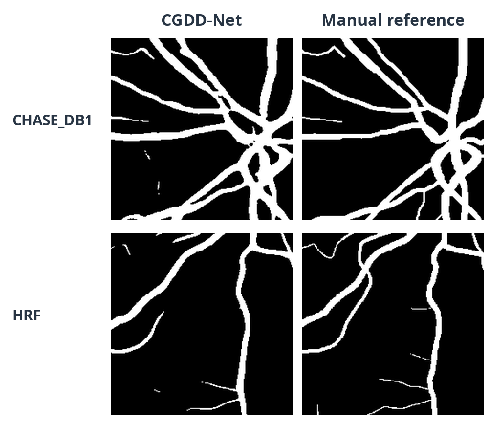
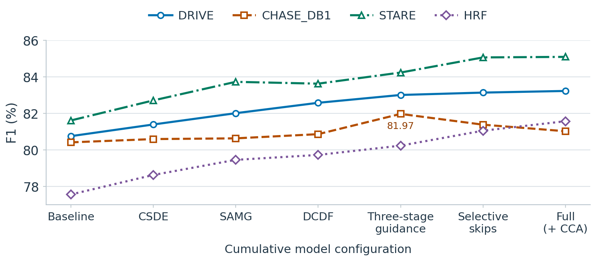
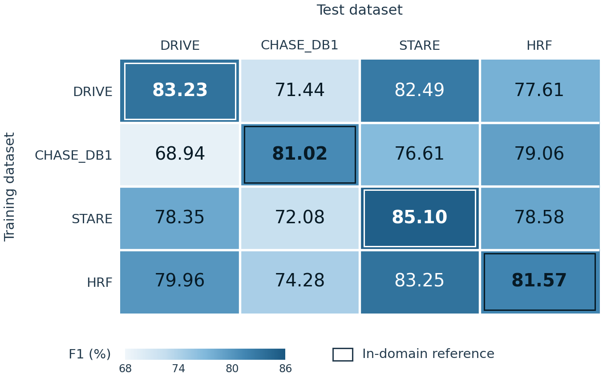
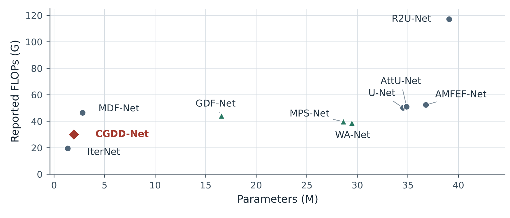

# CGDD-Net 论文代码

**Context-Guided Dynamic Detail Modeling for Retinal Vessel Segmentation**

作者：**Xincheng Li, Xiaoqi Sheng, Xinyu Zhang**。

本仓库提供与当前论文结构对应的 PyTorch 实现，包括：

- Context-Guided Scale-Adaptive Deformable Encoding（CSDE）；
- Spatially Adaptive Multi-Kernel Gating（SAMG）；
- Dynamic Cross-Scale Detail Fusion（DCDF）；
- 共享细节引导解码与选择性跳跃连接；
- D3 融合后的单个 Criss-Cross Attention（CCA）模块。

完整使用说明见 [英文 README](README.md)，结构细节见 [architecture.md](docs/architecture.md)，数据协议见 [data_protocol.md](docs/data_protocol.md)。

[](assets/architecture.png)

## 与论文一致的默认结构

- 输入：单通道灰度图；
- 五级编码通道：`8 / 16 / 32 / 64 / 128`；
- 共享细节通道：`8`；
- 完整模型参数量：**1,956,802（约 1.96 M）**；
- CSDE 注意力尺度：`1 / 3 / 5 / 7`，每个头使用 3×3 九点参考采样；
- SAMG 卷积核：`1 / 3 / 5 / 7`；
- SAMG 在 E2、E3、E4 的每个空间位置为四种卷积核分配权重。DCDF 将三层特征对齐到 E3 的分辨率，融合成一张八通道细节图。D3、D2、D1 各自学习如何将这张图用于当前分辨率的血管重建；
- 直接编码器跳跃连接保留 E4 和 E1；
- 下采样和主路径上采样后的通道投影均采用 `1×1 Conv-BN-ReLU`；
- 最终预测头为裸 `1×1 Conv`，输出 logits。

<details>
<summary>展开 CSDE、SAMG 和 DCDF 模块结构图</summary>

CSDE 将固定网格卷积分支与局部可变形注意力分支的输出融合。

[](assets/csde.png)

SAMG 结合全局和局部特征，在每个位置为 1×1、3×3、5×5 和 7×7 四种卷积核的响应分配权重。

[](assets/samg.png)

DCDF 将加权后的 E2、E3、E4 特征对齐到 E3 的分辨率，沿通道拼接，再投影为八通道细节图。

[](assets/dcdf.png)

</details>

七组累积消融为：

`baseline -> csde -> samg -> dcdf -> detail_decoder -> selective_skip -> full`

## 训练与推理

默认参考配置：

- Adam；
- 基础学习率 `0.001`；
- 训练 batch size `64`；
- 固定 `100` 轮，默认关闭 early stopping；
- 训练 patch `64×64`；
- 每轮采样 `150000` 个 patch；
- weight decay `0`；
- 5 轮线性 warmup，之后使用带重启的余弦调度；
- Dropout 为 `0.1`。在 [CHASE_DB1 超参数实验](results/paper_sensitivity.csv)中，分别改变 dropout、批大小和学习率，记录每种设置下的准确率；
- 推理 patch `64×64`，stride `16`，推理 mini-batch 默认 `8`；
- patch logits 经 sigmoid 后，在重叠位置平均概率并重构整图，再以 `0.5` 二值化。

损失函数为 FOV 掩码加权的 BCEWithLogits：

```python
loss = (
    F.binary_cross_entropy_with_logits(logits, target, reduction="none") * fov
).sum() / fov.sum()
```

没有额外 Dice、边界、拓扑、类别重加权或深监督损失。

## 论文结果

| 数据集 | SE | SP | ACC | F1 | AUC |
|---|---:|---:|---:|---:|---:|
| DRIVE | 0.8421 | 0.9768 | 0.9704 | 0.8323 | 0.9824 |
| CHASE_DB1 | 0.8600 | 0.9815 | 0.9752 | 0.8102 | 0.9938 |
| STARE | 0.8661 | 0.9812 | 0.9775 | 0.8510 | 0.9895 |
| HRF | 0.8362 | 0.9823 | 0.9711 | 0.8157 | 0.9874 |

上表节选自 Xincheng Li 的学位论文 *Adaptive Context Modelling and Detail-Guided Reconstruction for Retinal Vessel Segmentation*。训练／测试图像数依次为 DRIVE `20/20`、CHASE_DB1 `20/8`、STARE `10/10`、HRF `25/20`，采集视野角度依次为 45°、30°、35°、60°。[完整域内结果](results/paper_results.csv)还列有 mIoU 和 HD95（均值 ± 标准差）。[四个数据集的文献对比表](results/paper_comparisons.csv)逐行注明得分来源和原表编号，各研究的测试集划分有所不同。

<p align="center"><a href="assets/qualitative_examples.png"></a></p>

每行左侧为 CGDD-Net 预测，右侧为同一区域的人工标注。CHASE_DB1 示例中，多条血管在视盘附近汇聚。HRF 示例中，模型分出了近乎垂直的主干，但人工标注中一条连续的细小侧支在预测图中出现了断点。[数据来源与许可](NOTICE)

将细节图从仅送入 D3 改为同时送入 D3、D2、D1 后，DRIVE、CHASE_DB1、STARE 和 HRF 的 F1 分别提高了 0.43、1.11、0.61 和 0.51 个百分点。CHASE_DB1 在这一步取得了[七阶段消融实验](results/paper_ablation.csv)中的最高 F1（0.8197）。

<details>
<summary>展开四个数据集的七阶段 F1 消融曲线</summary>

[](assets/ablation_f1.png)

</details>

在[十二个跨数据集迁移方向](results/paper_transfer.csv)上，与在目标数据集训练并在同一批图像上测试的模型相比，F1 下降了 1.85 至 14.29 个百分点。

<p align="center"><a href="assets/transfer_f1.png"></a></p>

行表示训练集，列表示测试集，带边框的对角线单元格是域内参考值。固定阈值为 0.5 时，DRIVE → CHASE_DB1 的 F1 为 71.44%，反向迁移为 68.94%。

## 使用方法

```bash
python -m pip install -e '.[dev]'
python -m pytest -q
python scripts/smoke_test.py
```

训练示例：

```bash
python train.py --config configs/default.json \
  --train-manifest splits/new_drive/train.json \
  --val-manifest splits/new_drive/val.json \
  --data-root ../datasets \
  --output runs/drive_seed42 \
  --device cuda
```

评估示例：

```bash
python evaluate.py \
  --checkpoint runs/drive_seed42/best.pt \
  --manifest splits/new_drive/test.json \
  --data-root ../datasets \
  --output runs/drive_seed42/test \
  --device cuda
```

AUC 使用整图重建后的概率图，SE、SP、ACC 和 F1 使用阈值分割后的二值图。提供视野掩码时，仅评估掩码内的像素。未提供掩码时，评估整张图像。对每项指标，先逐图计算，再对具有有效得分的图像取算术平均。仓库可导出逐图指标、概率图、二值预测和运行配置。

作者确认计算使用 NVIDIA H200 141 GB、Python、PyTorch 和 CUDA；本地工作站为 Mac。Mac 的系统不能被直接写为 H200 计算主机的系统；原运行的具体系统及软件版本未在此断言。CPU 自动测试仅验证代码行为，不替代数据集实验。

## 数据与发布

DRIVE、STARE、CHASE_DB1 和 HRF 数据需从原始提供方获取，仓库不重新分发数据。数据划分通过 manifest 明确记录；新生成的实验划分会与论文结果转录区分。

模型参数和当前实现的部分算子统计可通过：

```bash
python scripts/profile_model.py --config configs/default.json --batch-size 64 --height 64 --width 64
```

该命令明确记录 `64×1×64×64` 的前向输入；安装 `.[profile]` 后追加 `--fvcore`，可输出支持算子的计数、每 patch 归一化结果、工具版本及不支持的算子。`--batch-size 1` 用于单 patch。

学位论文表 4.16 报告 CGDD-Net 有 **1.96 M** 个可训练参数，计算量为 **29.96 GFLOPs**。GDF-Net（16.57 M，44.06 G）、MPS-Net（28.63 M，39.69 G）和 WA-Net（29.47 M，38.68 G）采用相同的输入形状和工具测量。CGDD-Net 的 FLOPs 来自另一份记录。详见[十种模型对照表](results/paper_complexity.csv)、[参数量与 FLOPs 散点图](assets/parameters_flops.pdf)和[仓库计算量记录](docs/profile_measured.json)。

[](assets/parameters_flops.pdf)

圆点表示 Ma 等人报告的计算量，三角形表示在同一设置下测量的三种模型，菱形表示 CGDD-Net。

`summarize_runs.py` 用于分析多次训练得到的得分。早期论文表 7 以每张重建测试图像的 AUC 为一个观测值，其统计记录和 `scripts/exact_p_bounds.py` 所计算的理论界限见[数据协议](docs/data_protocol.md)。

仓库许可证、上游工作流归属和第三方许可信息见 `LICENSE`、`NOTICE` 和 `LICENSES/`。
